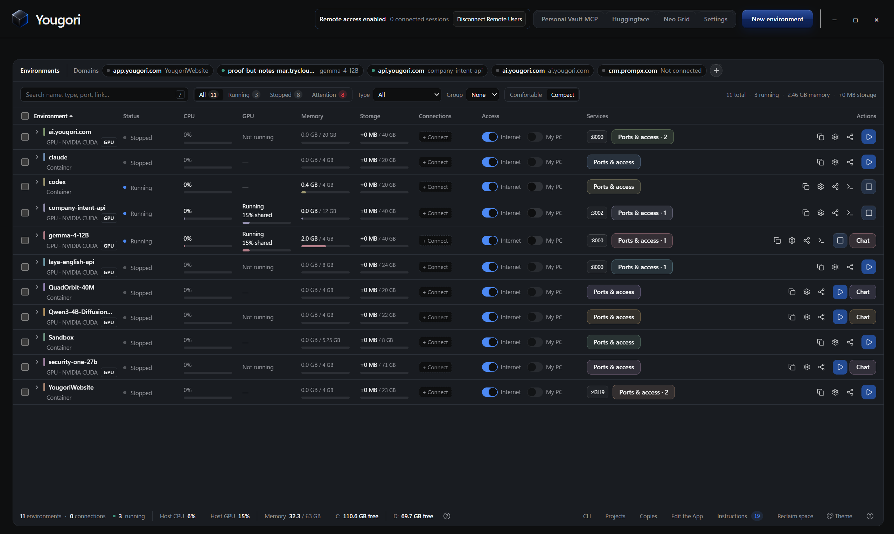

<div align="center">

# Yougori

### Whole setups, from one template.

A template describes a complete setup: its sandboxes, AI tools, models, data and public links.<br>
Run one with a single command, or make your own and share it on the Hub. Use the CLI or App.

<br>

[](LICENSE)
[](#run-from-source)
[](package.json)

**[Website](https://yougori.com/)** &nbsp;·&nbsp; **[Hub](https://yougori.com/hub)** &nbsp;·&nbsp; **[Discord](https://discord.gg/Eqhf4Hq3AG)** &nbsp;·&nbsp; **[X](https://x.com/withYougori)** &nbsp;·&nbsp; **[Run from source](#run-from-source)**

<br>




</div>

<br>

## Run a template

A template is a folder: a `yougori-template.yaml` that says what the setup is and what it asks, a
normal `yougori.yaml` project, and the app's own files. Run one from the Hub:

```bash
yougori run hub/PUBLISHER/NAME
```

Yougori downloads the version, checks every file against its checksum, shows what it will create
and what it may do on your computer, asks its questions, and only then builds it. Pin a version
with `@VERSION` (`hub/acme/my-api@1.2.0`) to run exactly that one.

Nothing on the Hub is checked by Yougori. Only templates uploaded by the Yougori owner account
carry the **Verified** badge; read a community template's files before you run it.

The templates Yougori maintains are in [`examples/hub`](examples/hub). Run one from its folder:

```bash
yougori template run ./examples/hub/hello-site
```

Hello site runs on every release. The others use the newer template format and need Yougori 1.2.0
or newer; an older Yougori says so and creates nothing.

| Template | What it sets up |
| --- | --- |
| Hello site | A one-page website in a container, online through a quick link or your own domain |
| AI Workspace | A sandbox with the AI coding tools you pick, each signed in your way, and a folder that keeps your files |
| Agent Tools | A coding agent in its own sandbox, with the tools and folders you choose |
| Dev Workspace | Your project folder kept in step with a sandbox, both ways |
| Host My App | A web app or API from its container image, shared through a quick link or your own domain |
| App Backend | Your app beside PostgreSQL and, if you want, Redis, with their data on volumes |
| Model Server | An open model on your GPU or processor, behind a private OpenAI-compatible API |
| Model Collection | Two or three open models on one computer, loaded as they are asked |
| Inference Endpoint | A Hugging Face model served with vLLM on your NVIDIA GPU |
| GPU Lab | JupyterLab with PyTorch and CUDA on your NVIDIA GPU |
| Shared Workspace | One of your sandboxes shared with one person, through a private link and their own password |
| Backup Workflow | Your app with its data on a volume, backed up on a schedule you choose |
| Operations Dashboard | Every setup's state, health and backups in one place, kept on your computer |
| My API | A model API website with accounts, keys and prepaid credits |

Each running copy is an instance with its own name:

| What you want to do | Command |
| --- | --- |
| List your instances | `yougori template list` |
| See how one is doing | `yougori template status INSTANCE` |
| Finish one that stopped partway | `yougori template continue INSTANCE` |
| Move it to a newer version | `yougori template update INSTANCE` |
| Stop it, keeping its data | `yougori template down INSTANCE` |
| Remove it | `yougori template rm INSTANCE --yes` |

## Make your own

```bash
yougori template new my-template      # Start a template folder
yougori template check                # Validate it and see exactly what it would create
yougori template publish              # Upload it to the Hub as a new version
```

`yougori template capture ENV` turns sandboxes you already have into a template, leaving out
disks, sign-ins, secret values and anything else personal. `check` and `publish` refuse keys,
passwords, live invitations and anyone's own details. Everything on the Hub is public, open source
and free. The formats, every command and the review a template gets are in [the Hub
reference](docs/hub.md).

## Run a model. Make it yours.

Choose a supported Hugging Face model and give it a place to run. Start locally:

```bash
yougori model run hf.co/TinyLlama/TinyLlama-1.1B-Chat-v1.0
```

Yougori guides you through setup and opens a chat when the model is ready. To use Neocloud compute, connect your RunPod account and create or attach a GPU pod through the `yougori` menu, then run:

```bash
yougori model run hf.co/TinyLlama/TinyLlama-1.1B-Chat-v1.0 --neocloud
```

Need the model in your app? Start it with `--api`:

```bash
yougori model run hf.co/TinyLlama/TinyLlama-1.1B-Chat-v1.0 --api --port 8000
```

Use the model's environment name or ID in place of `ENV` below. `yougori ps` lists them.

| What you want to do | Command |
| --- | --- |
| Return to a conversation | `yougori model chat ENV` |
| Start a fresh conversation | `yougori model chat ENV --new` |
| Get the API key and connection addresses | `yougori model access ENV` |
| Check the model | `yougori model status ENV` |
| See API usage | `yougori model usage ENV` |
| Stop the model process | `yougori model stop ENV` |

Stopping a model on Neocloud leaves its pod billable. Manage the pod separately in the Neocloud menu.

To share your own model files, upload them to the model library with model cards, versions and licenses; see [Model publishing](docs/model-publishing.md).

## AI tools in your terminal

Run AI coding tools in isolated sandboxes that keep their files. Launch them directly with `yougori codex` or `yougori claude`, choose the folders and connections they get, and share the sandbox with someone at the permission level you choose. See [Tool containers](docs/tool-containers.md) and [Remote sharing](docs/remote-sharing.txt).

## Give agents access you approve

Personal Vault MCP keeps credentials and personal information in an encrypted vault on your computer. Your agent requests what it needs; you review the request and approve access.

Run `yougori` and choose **MCP Vault** to open the vault, add an item, review approvals or get your MCP connection settings. Item entry and approvals use the Windows App, which is installed separately from the CLI.

For an MCP client that supports local stdio servers, use:

```json
{
  "mcpServers": {
    "yougori-vault": {
      "command": "yougori",
      "args": ["vault", "mcp"]
    }
  }
}
```

The client must be able to find `yougori` on its PATH. The MCP Vault menu can generate settings with the full executable path. For connection options and approval behavior, see [Personal Vault](docs/personal-vault.txt).

## Keep the rest within reach

Use the guided menu to create containers and VMs, manage Neocloud compute, share folders and set up connections. These commands are useful when you already know what you want:

```bash
yougori status                  # Environments, links and jobs
yougori run -it ubuntu           # Open a shell in an Ubuntu container
yougori terminal ENV             # Open a terminal in an existing environment
yougori logs ENV                 # Read its logs
yougori stop ENV                 # Stop an environment
yougori help                     # Full command reference
```

For projects with several services, describe the environments and connections in [`yougori.yaml`](examples/yougori.yaml). Run `yougori up --dry-run` to preview, `yougori up` to start, and `yougori down` to stop them without deleting their volumes.

More detail: [projects and models](docs/projects-and-models.txt).

<br>

## Run from source

You'll need **Git**, **Node.js 24 LTS** and **Rust stable**.

<details open>
<summary><b>Windows x64</b>: PowerShell</summary>

<br>

```powershell
git clone https://github.com/you-gori/yougori.git
Set-Location yougori
rustup default stable-x86_64-pc-windows-msvc
npm ci
npm run cli:bundle
npm run desktop:dev
```

</details>

<details>
<summary><b>Ubuntu 22.04+ x64</b>: Terminal</summary>

<br>

```bash
sudo apt update
sudo apt install -y build-essential pkg-config libwebkit2gtk-4.1-dev \
  libgtk-3-dev libayatana-appindicator3-dev librsvg2-dev patchelf \
  libssl-dev libxdo-dev qemu-system-x86 qemu-utils ovmf \
  openssh-client ca-certificates

git clone https://github.com/you-gori/yougori.git
cd yougori
npm ci
npm run cli:bundle
npm run desktop:dev
```

</details>

<details>
<summary><b>macOS 14+</b>: Terminal &nbsp;<sub>development preview</sub></summary>

<br>

```bash
git clone https://github.com/you-gori/yougori.git
cd yougori
npm ci
npm run macos:setup
npm run cli:bundle
npm run desktop:dev
```

</details>

<br>

## Documentation

| | |
| --- | --- |
| [Hub: templates and tools](docs/hub.md) | Running, making and publishing templates; the formats and every command |
| [Projects, CLI and models](docs/projects-and-models.txt) | Every command, `yougori.yaml` fields and the model runner |
| [Neocloud](docs/neocloud.md) | Renting GPUs, pods, serverless endpoints and volumes |
| [Model publishing](docs/model-publishing.md) | Model pages, downloads, open and closed weights |
| [Tool containers](docs/tool-containers.md) | AI tools running directly in your terminal |
| [Remote sharing](docs/remote-sharing.txt) | Tunnels, domains, recipients and permission levels |
| [Personal Vault](docs/personal-vault.txt) | Encrypted credential broker for agents |
| [Build cache](docs/build-cache.md) | Faster Rust builds during development |
| [Licensing](docs/licensing.txt) | AGPL, commercial licensing and source distribution |

<br>

## License

Yougori's original code is open source under **[AGPL-3.0-only](LICENSE)**. A **[separate commercial agreement](COMMERCIAL_LICENSE.txt)** may be requested from the relevant copyright holders. Commercial use is allowed under the AGPL when its conditions are met. Third-party components keep their own licenses. See [NOTICE](NOTICE) and the [licensing guide](docs/licensing.txt).

<br>

<div align="center">

<sub>Made by Yougori</sub>

</div>
